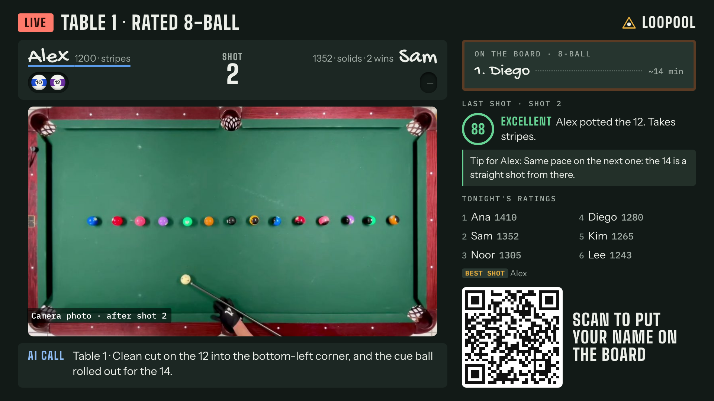
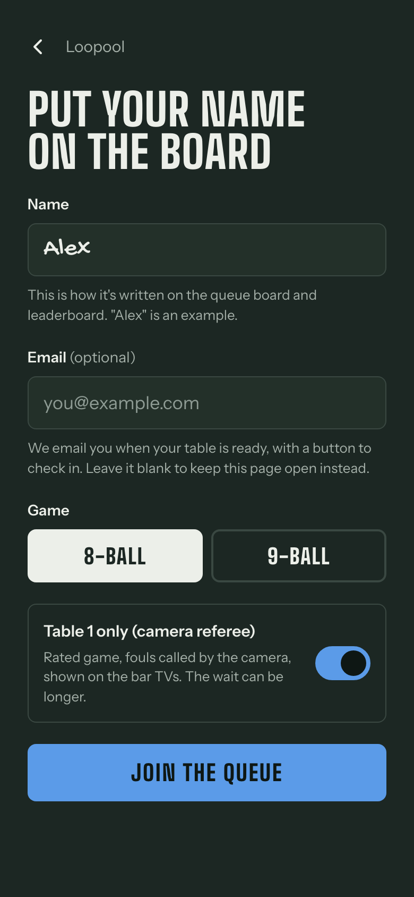
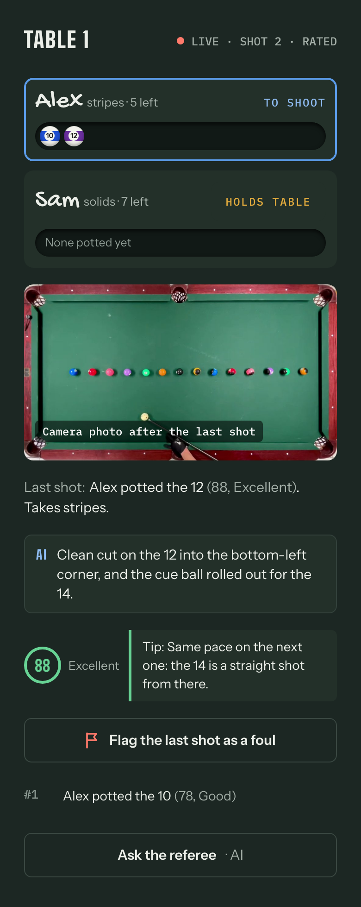
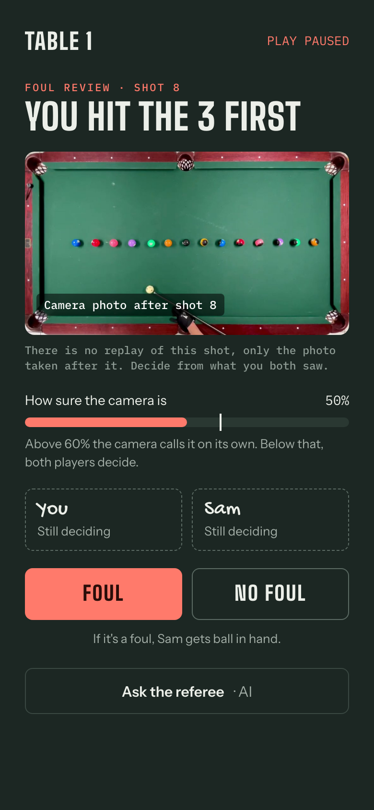
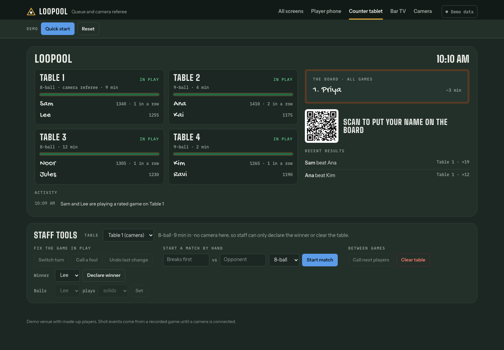
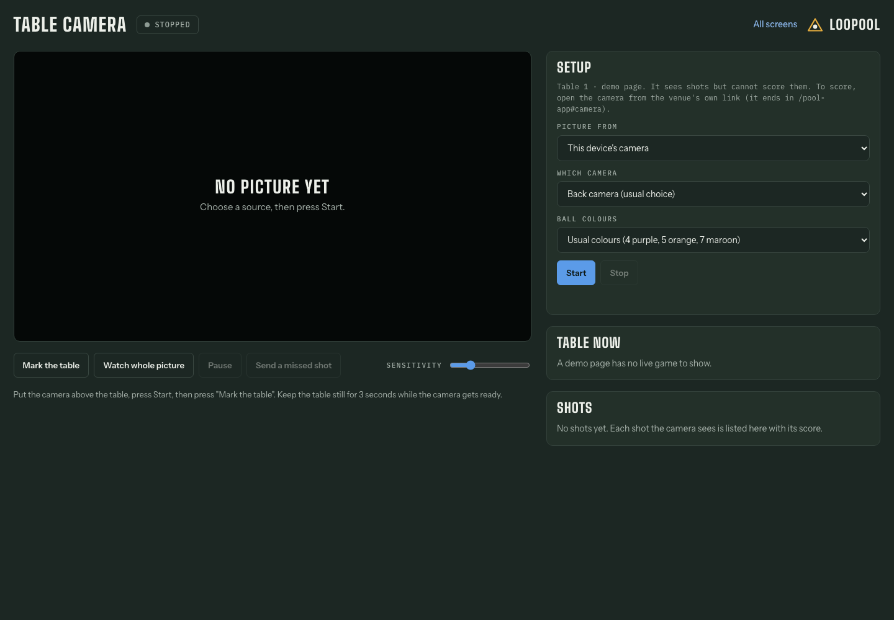

# Loopool

**A pool hall run by one n8n workflow: a fair queue for the tables, and an AI referee that watches every shot.**



**Try it:** [the demo version](https://nickkklian.github.io/loopool/) runs all four screens in your browser on made-up data (no n8n needed).

In most bars the pool queue is coins on the rail or a name on a chalkboard, and arguments about who hit what are settled by whoever is loudest. Loopool replaces both:

- **A fair queue.** Players scan the QR code on the bar TV, put their name on the board from their phone and get an email when their table is free. They check in with one tap. Winner stays on, up to 3 wins in a row while others wait.
- **An AI referee.** A phone or webcam above the table sends photos of each shot to n8n once the balls stop. An AI vision model says which balls went in, which ball was hit first and whether the cue ball dropped. Code turns that into a 0-100 shot score with a tip and applies the rules: turns, solids and stripes, fouls, ball in hand, the winner and the players' ratings. If the AI is unsure about a foul, play pauses and the players confirm on their phones; staff can correct any call from the counter tablet.
- **For the bar.** A TV screen with the live game, the photo and the AI's call after each shot and tonight's ratings, plus "Ask the referee": an AI that answers rules and queue questions from the house rules and the live board.

## Screens

Players and bars get separate apps. A first visit asks "I'm here to play" or "I run a bar"; the profile menu switches sides.

| App | Address | Used by |
|---|---|---|
| Player app | `/webhook/pool-app#play` (the bar's QR code opens `#mobile&bar=home`) | Players, on their phone. Enter your name and email → **Home**: the best bar right now (closest, shortest wait), scan a QR code, your rating and games → a bar's page → **Join the queue** → your place, the wait and the live game → called (3-minute timer and an email naming your table and opponent) → playing (ask the referee, flag a foul) → result (new rating and rank; play again or stop). After the first game you add a password to keep playing. **Bars**, **Ranks** and **Me** are tabs. |
| Bar app | `/webhook/pool-app#bar` | Owners and staff, on a tablet or phone. Register the bar once (auto-filled from a website or Google Maps link). Home page: the bar's facts, events, **Start a game** (by hand, from the queue, or with the camera → camera set-up → the bar TV view, until **Exit TV view**). The profile icon edits the bar (already filled in), switches to the player app or deletes the bar. |
| Bar TV | `/webhook/pool-app#tv` | The screen above the bar |

`index.html` is the same app in one file, running on demo data in any browser, with no n8n needed.

| Join from the phone | A shot, called by the AI | A disputed foul | Counter tablet | Table camera |
|---|---|---|---|---|
|  |  |  |  |  |

## How it works

```
camera page (#camera)                         n8n workflow
─────────────────────                         ────────────────────────────────────────────────
motion starts → keeps a "before" photo
balls still for 1.5 s → "after" photo
a ball really moved? ──yes──► POST /pool-score ─► AI reads the shot (photos + the table's ball colours)
                                                ─► Score the shot: 0-100 from a fixed rubric
                                                ─► POST /pool-apply (its own short run):
                                                   Referee engine: turn, groups, fouls, winner, ratings
                     ◄──────── score + game result
phones, TV, tablet ◄── /pool (every 4-20 s) + /pool-frame (the after photo)
email buttons      ──► /pool-act   (check in, vote on a foul, confirm a result)
"Ask the referee"  ──► /pool-ask   (AI agent with the house rules and the live board)
```

The whole backend is one workflow (`pool-referee.n8n.json`, 56 nodes) that also serves the app. The camera page detects shots in the browser (frame differencing with fixed start and end levels, chosen by replaying labelled pool videos through it), so n8n only receives the shots that matter. The AI only describes what it sees; the score and every rule are plain code, so the same shot always gets the same ruling. State is kept in the workflow's static data, which n8n saves when a run ends, so anything slow runs apart from the state: the 15-second AI call hands its result to a short `/pool-apply` run, and emails go out from a background sub-run.

## How we chose the AI model

<!-- accuracy:start -->
We didn't want to guess which vision model should referee, so we built a test inside n8n: 184 real shots cut from 10 public overhead pool videos, each labelled frame by frame, sent to 6 vision models through a second n8n workflow on n8n's AI credits, and scored exactly the way the live referee reads an answer.

- **Claude Haiku 5.5 came out as the most cost-effective:** at least as accurate as models up to ten times its price, at about 0.2¢ a shot.
- **Seeing that a ball dropped is the easy part; naming it is the hard part.** From above a ball is about 20 pixels wide, so the models go by colour.
- **One setting helped most:** telling the model the table's ball colours made its calls clearly more accurate, so the camera page now asks for them.

Models tested: Claude Haiku 5.5, Claude Sonnet 5.5, GPT-6 Luna, GPT-6.1 Terra, Gemini 3.1 Flash-Lite and Qwen3-VL Plus.
<!-- accuracy:end -->

## Set it up (about 10 minutes)

1. In n8n: **Create workflow → ⋯ → Import from file →** `pool-referee.n8n.json`.
2. Open the three AI nodes (**AI reads the shot**, **Claude (commentator)**, **Claude (n8n Gateway credits)**) and pick a credential. On n8n Cloud, **Gateway credits** works without an API key; elsewhere use an Anthropic key.
3. Open **Send email (Gmail)** and connect a Gmail account (it sends the "your table is ready" emails). To skip email, deactivate that node.
4. **Publish**, then open `https://YOUR-NAME.app.n8n.cloud/webhook/pool-app`.

### The camera

1. Mount a phone or webcam above the table, looking straight down, with the table filling the picture. Open `#camera` (the page is served over https, so phones allow the camera).
2. Pick the table's **ball colours** (the usual set, or a set where the 4 is pink, the 5 purple and the 7 orange). In our test this one setting made the calls clearly more accurate.
3. Press **Start** and keep the table still for 3 seconds while it gets ready. The camera watches the whole picture, so mount it once with the table filling the frame.
4. Play. A shot is sent once the balls have been still for 1.5 seconds; someone leaning over the table without moving a ball is ignored.

**Several tables from one device:** press **Add table** at the top of the camera page to give another table its own tab (for example a laptop with a USB webcam over each table). Each tab has its own camera, ball colours and shot log, and keeps watching while you look at another tab; the dot on each tab shows whether that table is watching, mid-shot or paused. On Tables 2-4 the camera referees every game that starts while its camera is running (those games are not rated; only Table 1 is). A game that was already going when the camera started is scored as practice shots.

For a demo without a table, choose **A recorded video (for demos)** under **Picture from**, and the page treats the video as a live feed.

## Rules

- **8-ball:** a ball potted on the break keeps the breaker at the table and the table stays open. The first legal pot after the break sets solids and stripes. Pot your own ball without a foul and you keep shooting. Fouls (scratch, wrong ball first, no ball hit, or a foul the AI saw) give ball in hand. The 8 is legal only after your group is cleared; early or on a foul, the opponent wins. When the AI cannot see which ball was hit first, no first-ball foul is called.
- **9-ball and 10-ball:** pot something without a foul and you keep shooting; the money ball (9 or 10) potted without a foul wins; a ball potted on a foul comes back and the opponent has ball in hand.
- **Ratings:** Elo, with K = 48 for a player's first 5 matches and 32 after, times a margin factor (1 + 0.05 × balls the loser still had), plus up to ±5 from the player's average shot score in that match.
- **Queue:** winner stays on, at most 3 wins in a row while people wait; 3 minutes to check in when called.

## Costs

- Reading a shot sends 6 photos and a change map to the AI model. With Claude Haiku 5.5 on n8n's AI credits that is about 0.2 US cents a shot; Claude Sonnet 5.5 costs about ten times more and was not more accurate in our test.
- Every screen checks for updates every 4 seconds while something is happening and every 20 seconds when nothing is, and never while hidden. Each check is one n8n execution, which counts toward n8n Cloud plan limits.

## Limits

- The AI reads still photos, so very fast or hidden moments can be missed; that is why unsure fouls go to a player vote and staff can undo any call.
- Our test footage has almost no fouls, so the test shows the AI rarely calls a foul that did not happen, not how well it catches real ones.
- The camera page decides when a shot starts and ends from how much of the picture changes. It can still miss a shot, or join two shots into one, when arms and cues stay over the table between shots; **Send a missed shot** on the camera page covers that.
- Two requests that land within about a tenth of a second of each other can still overwrite each other's change (a limit of workflow static data).
- State lives in the workflow's static data: right for one venue. For more traffic, move it to Postgres or n8n Data Tables (the engine code stays the same).

## What's in this repository

| Path | What it is |
|---|---|
| `pool-referee.n8n.json` | **Import this.** The whole backend in one n8n workflow; it also serves the app. |
| `index.html` | The same app in one file, on demo data, for any browser. |
| `source/` | App and workflow sources. `node source/build.js` rebuilds `index.html` and `pool-referee.n8n.json`. |
| `API.md` | Endpoints, actions, the `/pool-score` format and the rules. |
| `screenshots/` | The screens. |

## Team

Loopool was built by Nick Lian, Nic Saunders, Ava Soh and Ibrahim Tekkanat at the UBC eProjects × n8n LOOP Hackathon, November 2026.

## Built with, and outside services

- **n8n Cloud**: webhooks, Code, Switch, Execute Workflow, Respond to Webhook, the AI Agent node, Anthropic image analysis, Gmail; state in workflow static data.
- **AI models**, through n8n's built-in AI credits: Claude Haiku 5.5 (Anthropic) reads the shots and answers "Ask the referee". For the accuracy test we also ran Claude Sonnet 5.5 (Anthropic), GPT-6 Luna and GPT-6.1 Terra (OpenAI), Gemini 3.1 Flash-Lite (Google) and Qwen3-VL Plus (Alibaba Cloud).
- **Gmail** for the queue emails, **Google Fonts** (Big Shoulders, Gochi Hand, Instrument Sans, IBM Plex Mono), **qrcodejs** from cdnjs for the QR code.
- **Test footage**: public YouTube videos used to test the referee, "Pool Drill 8 - Overhead View" and other drills from The Billiard Room by Jason Creglia, and "8 Ball Lesson - GoPro top view runout breakdown" from Misha's Billiards. A few still frames appear in the screenshots; the videos themselves are not included here.
- **OpenCV** (Python) for an earlier computer-vision referee and for cutting test shots from the footage; neither is part of this version.
- AI coding assistants helped write and test the code.
